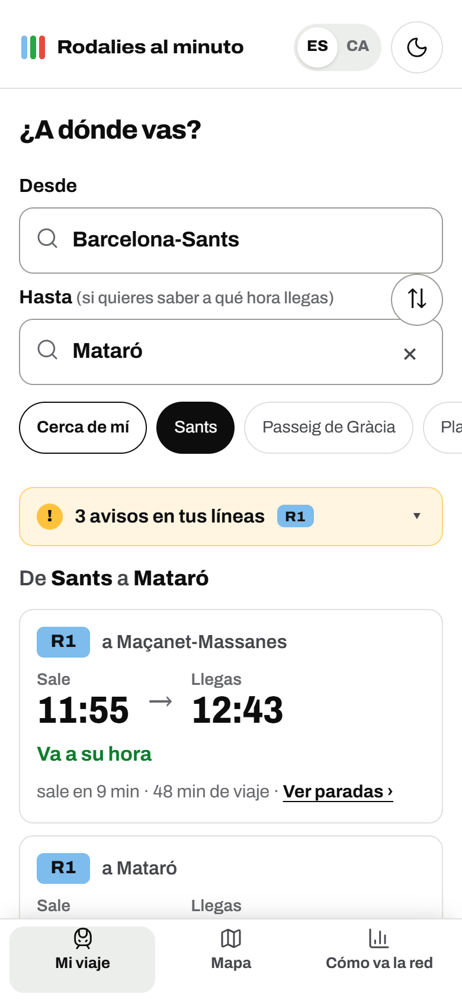
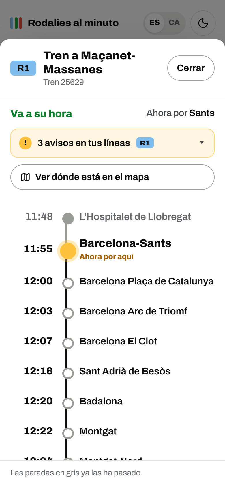
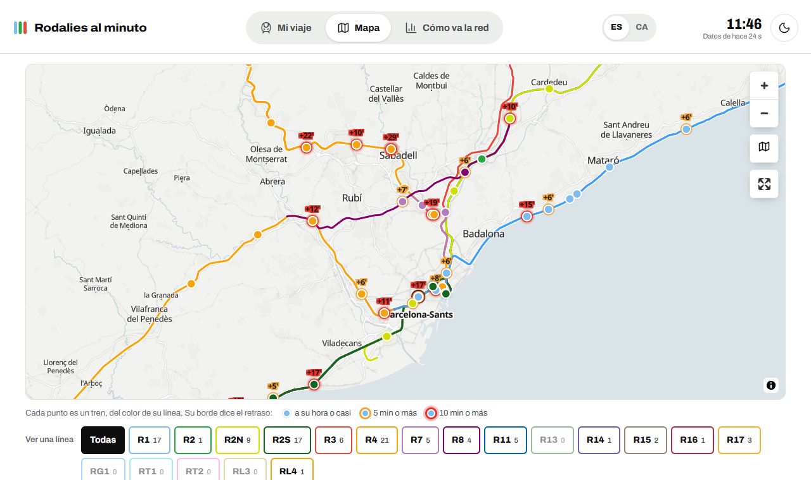

# Rodalies al minuto

**Live delays for every Rodalies (Barcelona commuter rail) train — and when you'll actually arrive.**
→ **https://rodalies.reloda.es** · [en català](https://rodalies.reloda.es/ca/)

Renfe publishes "+8 min" and leaves the maths to you, has no history of how punctual each train really is, and
during disruptions trains silently vanish from its feed. Rodalies al minuto turns Renfe's raw open data into
answers people need on the platform: *my train, when it leaves, when I get there, and whether something is wrong*.

<p align="center">
  
  
</p>
<p align="center"></p>

## What it does

- **My trip** — pick where you're going and see each direct train with its **real** departure and arrival time
  (timetable + current delay), stated in plain words ("8 minutes late").
- **Stop-by-stop view** — tap any train: estimated time at every station, where it is now, where you get on and off.
- **Live map** — every train on its line, sliding between GPS positions; the ones running 10+ minutes late pulse.
- **Problems surfaced, not hidden** — Renfe's alerts (in Spanish or Catalan), bus replacement services, and a
  detector for lines whose trains have disappeared from the feed ("the R8 may not be running: 6 trains should
  be out and Renfe reports 0").
- **Punctuality history Renfe doesn't publish** — a collector stores the state of every train every minute;
  hourly roll-ups give on-time rates per line.
- **For everyone** — Spanish and Catalan, light/dark, installable PWA, works offline with the last data, big
  type and plain language in the main view, keyboard and screen-reader friendly.
- **Found on Google** — a static page per station in both languages (416 pages) with its lines, frequent
  destinations and nearby stations, plus hreflang, structured data and a generated sitemap.

## How it works — €0/month on Cloudflare's free tier

```
 Renfe GTFS-RT (JSON, public)                     Cloudflare
 ─────────────────────────────                    ───────────────────────────────────────────────────────────
 trip_updates.json  ──every minute──▶  Worker  rodalies-colector (cron)
 alerts.json        ──every 2 min──▶     ├─ D1: capturas (1 row/min, kept 8 days) · resumen (1 row/train/day)
                                         ├─ D1: active alerts · suggestions
                                         └─ RPC ─▶ Durable Object «Directo» ──WebSocket push──▶ every open page
 vehicle_positions.json ◀──every 20 s, only while someone is watching──┘   (one connection per visit)

 GTFS (static, weekly) ──GitHub Action──▶ timetables per day, line shapes, 416 station pages ──▶ Pages (static)
                                                                        Pages Functions: /api/vivo · /api/lineas
```

Design choices worth noting:

- **Push instead of polling.** Each open page holds one hibernatable WebSocket to a single Durable Object, which
  broadcasts new delays every minute and GPS positions every 20 s. A visit costs one request instead of two per
  minute — the free 100k requests/day go from ~800 to 50,000+ user-hours. If WebSockets fail, the page falls
  back to polling once a minute.
- **Hourly roll-ups, not nightly batches.** Summing a whole day in SQL would read ~2M rows (half of D1's free
  daily quota); adding the ~60 new snapshots every hour costs ~60 reads and ~120 writes.
- **Timetables as static files.** The GTFS is turned into one JSON per service day (~60 KB gzipped), so the
  "when do I arrive" maths runs in the browser and costs no requests.
- **Renfe quirks handled:** trip ids change prefix every service day (`5191M…`, `5192X…`), alerts label the
  Catalan text as `"es"`, cancelled trains are never marked as such (they just disappear), and some delays are
  impossible (−23 h) — all covered by tests.
- **No framework, no build step** for the site: plain ES modules, MapLibre (loaded only when the map is opened),
  and `node --test` for the logic.

## Repository

| Path | What's there |
|---|---|
| `colector/` | Worker with cron: captures, alerts, hourly roll-up, and the `Directo` Durable Object |
| `web/public/` | The site: `app.js` (UI), `tablero.js` (pure trip/departure logic), `mapa.js`, `i18n.js` |
| `web/functions/api/` | Pages Functions: `/api/vivo`, `/api/lineas`, `/api/directo` (WebSocket), `/api/sugerencia` |
| `scripts/` | `horarios.mjs` (GTFS → static JSON), `idiomas.mjs` (Catalan page), `estaciones.mjs` (station pages + sitemap), `local.mjs` (local server with live data) |
| `test/` | Tests for the parsers, trip maths, coverage detector and translations |
| `.github/workflows/horarios.yml` | Every Monday: fresh timetables, pages and deploy |

```bash
npm install
npm test
npm run local                 # http://localhost:8790 with production data
npm run desplegar:web         # timetables + Catalan + station pages, then deploy
npm run desplegar:colector    # deploy the collector and the Durable Object
npm run sugerencias           # read what people sent through the suggestion box
```

Collector health: `https://rodalies-colector.dimelo-game.workers.dev/estado`.

## Data and licence

Data: **Renfe Operadora** open data (real time and timetables), used under its reuse licence. Map: OpenFreeMap,
© OpenMapTiles, © OpenStreetMap contributors. Unofficial project, not affiliated with Renfe or Rodalies de
Catalunya.
